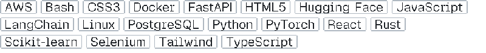
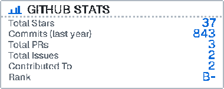
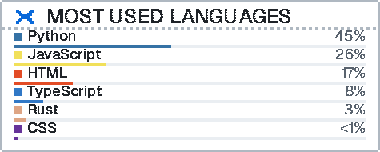
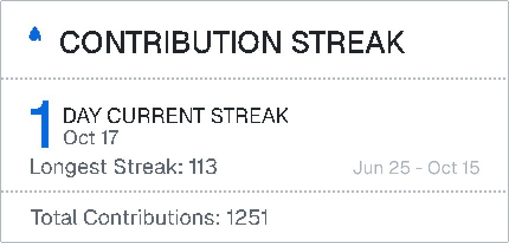

<picture>
  <source media="(prefers-color-scheme: dark)" srcset="assets/title-dark.svg">
  <source media="(prefers-color-scheme: light)" srcset="assets/title-light.svg">
  
</picture>

<picture>
  <source media="(prefers-color-scheme: dark)" srcset="assets/row-learning-dark.svg">
  <source media="(prefers-color-scheme: light)" srcset="assets/row-learning-light.svg">
  
</picture>

<a href="mailto:rjayadithya11@gmail.com" target="_blank">
  <picture>
    <source media="(prefers-color-scheme: dark)" srcset="assets/row-email-dark.svg">
    <source media="(prefers-color-scheme: light)" srcset="assets/row-email-light.svg">
    
  </picture>
</a>

<a href="https://jayadithya.is-a.dev" target="_blank">
  <picture>
    <source media="(prefers-color-scheme: dark)" srcset="assets/row-projects-dark.svg">
    <source media="(prefers-color-scheme: light)" srcset="assets/row-projects-light.svg">
    
  </picture>
</a>

<a href="https://jayadithya.is-a.dev/resume" target="_blank">
  <picture>
    <source media="(prefers-color-scheme: dark)" srcset="assets/row-resume-dark.svg">
    <source media="(prefers-color-scheme: light)" srcset="assets/row-resume-light.svg">
    
  </picture>
</a>

<picture>
  <source media="(prefers-color-scheme: dark)" srcset="assets/h-connect-dark.svg">
  <source media="(prefers-color-scheme: light)" srcset="assets/h-connect-light.svg">
  
</picture>

<a href="https://github.com/barryallen16" target="_blank">
  <picture>
    <source media="(prefers-color-scheme: dark)" srcset="assets/btn-github-dark.svg">
    <source media="(prefers-color-scheme: light)" srcset="assets/btn-github-light.svg">
    
  </picture>
</a>
<a href="https://linkedin.com/in/jayadithya-r" target="_blank">
  <picture>
    <source media="(prefers-color-scheme: dark)" srcset="assets/btn-linkedin-dark.svg">
    <source media="(prefers-color-scheme: light)" srcset="assets/btn-linkedin-light.svg">
    
  </picture>
</a>
<a href="https://leetcode.com/jayadithyx16" target="_blank">
  <picture>
    <source media="(prefers-color-scheme: dark)" srcset="assets/btn-leetcode-dark.svg">
    <source media="(prefers-color-scheme: light)" srcset="assets/btn-leetcode-light.svg">
    
  </picture>
</a>

<picture>
  <source media="(prefers-color-scheme: dark)" srcset="assets/h-tools-dark.svg">
  <source media="(prefers-color-scheme: light)" srcset="assets/h-tools-light.svg">
  
</picture>

<picture>
  <source media="(prefers-color-scheme: dark)" srcset="assets/tools-dark.svg">
  <source media="(prefers-color-scheme: light)" srcset="assets/tools-light.svg">
  
</picture>

<table>
  <tr>
    <td width="50%">
      <picture>
        <source media="(prefers-color-scheme: dark)" srcset="assets/stats-dark.svg">
        <source media="(prefers-color-scheme: light)" srcset="assets/stats-light.svg">
        
      </picture>
    </td>
    <td width="50%">
      <picture>
        <source media="(prefers-color-scheme: dark)" srcset="assets/top-langs-dark.svg">
        <source media="(prefers-color-scheme: light)" srcset="assets/top-langs-light.svg">
        
      </picture>
    </td>
  </tr>
  <tr>
    <td colspan="2">
      <picture>
        <source media="(prefers-color-scheme: dark)" srcset="assets/streak-dark.svg">
        <source media="(prefers-color-scheme: light)" srcset="assets/streak-light.svg">
        
      </picture>
    </td>
  </tr>
</table>
